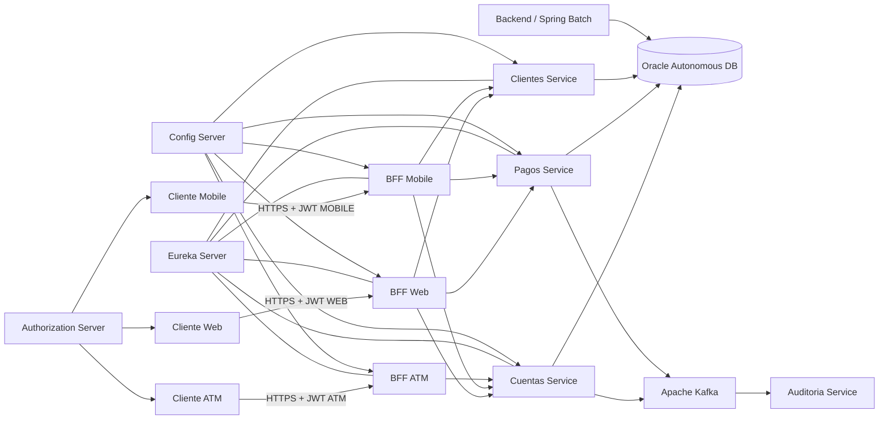

# Bank XYZ — Modernización Backend con Spring Batch, BFF y Microservicios en AWS

Proyecto desarrollado para la asignatura **Desarrollo Backend III (PBY2203)** de Duoc UC.

La solución moderniza el escenario legacy de **Bank XYZ** mediante una arquitectura distribuida basada en Spring Boot, Spring Cloud, Spring Batch, OAuth 2.0/JWT, Resilience4j, Apache Kafka, Oracle Autonomous Database, Docker Compose y despliegue real en AWS EC2.

> **Repositorio GitHub:** https://github.com/PanshoOw/Bank-XYZ-EFT

---

## 1. Objetivo del proyecto

Bank XYZ mantiene originalmente una plataforma legacy monolítica encargada de procesos bancarios críticos, procesamiento batch y atención de distintos canales.

El proyecto busca modernizar esa arquitectura mediante:

- migración de procesos legacy a Spring Batch;
- separación del sistema en microservicios;
- implementación del patrón Backend for Frontend;
- seguridad distribuida mediante OAuth 2.0 y JWT;
- tolerancia a fallos mediante Resilience4j;
- mensajería asíncrona mediante Apache Kafka;
- configuración y descubrimiento dinámico mediante Spring Cloud;
- contenerización mediante Docker;
- despliegue y escalabilidad horizontal en AWS.

---

## 2. Procesos críticos de modernización

La solución aborda los cinco procesos críticos considerados para la migración de Bank XYZ:

1. **Migración de procesos Batch a Spring Batch.**
2. **División del sistema monolítico en microservicios.**
3. **Implementación del patrón Backend for Frontend (BFF).**
4. **Implementación de seguridad distribuida mediante Spring Security, OAuth 2.0 y JWT.**
5. **Integración de mensajería asíncrona mediante Apache Kafka.**

---

## 3. Requerimientos de negocio y decisiones de arquitectura

### 3.1 Escalabilidad y disponibilidad

Los dominios de Cuentas, Pagos y Clientes se separaron en microservicios independientes.

Esto permite:

- desplegar cada dominio de manera independiente;
- escalar los servicios que presentan mayor demanda;
- reducir el acoplamiento respecto del backend monolítico;
- distribuir solicitudes entre múltiples instancias mediante Eureka y Spring Cloud LoadBalancer.

Durante la validación en AWS se ejecutaron **dos réplicas simultáneas** de Cuentas, Pagos y Clientes.

### 3.2 Seguridad específica para cada canal

Web, Mobile y ATM poseen necesidades distintas de información y seguridad.

Por esta razón se implementaron tres BFF independientes y scopes OAuth2 específicos:

| Canal | OAuth Client | Scope |
|---|---|---|
| Web | `bankxyz-web` | `WEB` |
| Mobile | `bankxyz-mobile` | `MOBILE` |
| ATM | `bankxyz-atm` | `ATM` |

Cada BFF valida únicamente los permisos asociados a su canal.

### 3.3 Resiliencia y procesamiento asíncrono

Las comunicaciones entre los BFF y los microservicios utilizan Resilience4j para evitar que una indisponibilidad temporal provoque una falla general del sistema.

Las operaciones monetarias no utilizan reintentos automáticos desde los BFF, evitando el riesgo de duplicar transacciones.

Apache Kafka desacopla las operaciones bancarias de la auditoría asíncrona.

---

## 4. Arquitectura general



---

## 5. Componentes

| Componente | Puerto | Responsabilidad |
|---|---:|---|
| Backend / Spring Batch | 8080 | Procesamiento batch y funcionalidades transicionales |
| BFF Web | 8081 HTTPS | Backend especializado para Web |
| BFF Mobile | 8082 HTTPS | Backend especializado para dispositivos móviles |
| BFF ATM | 8083 HTTPS | Consultas de saldo y retiros ATM |
| Cuentas Service | 8084 interno | Gestión de cuentas y retiros |
| Pagos Service | 8085 interno | Pagos, depósitos y transferencias |
| Clientes Service | 8086 interno | Gestión de clientes |
| Auditoria Service | 8087 interno | Consumo independiente de eventos Kafka |
| Eureka Server | 8761 | Service Discovery |
| Config Server | 8888 | Configuración centralizada |
| Authorization Server | 9000 | OAuth 2.0 y emisión de JWT |
| Apache Kafka | 9092 / 29092 | Mensajería asíncrona |

Todos los contenedores se comunican mediante:

```text
bankxyz-network
```

---

## 6. Estructura del proyecto

```text
Proyecto_EFT/
├── auth-server/
├── auditoria-service/
├── bff-atm/
├── bff-mobile/
├── bff-web/
├── clientes-service/
├── config-server/
├── cuentas-service/
├── discovery-server/
├── pagos-service/
├── src/                         # Backend principal / Spring Batch
├── Dockerfile
├── docker-compose.yml
├── .env.example
├── .gitignore
├── pom.xml
└── README.md
```

Para la entrega final se incorporan además:

```text
instrucciones.md
despliegue.md
Informe técnico PDF
Video presentación MP4
```

---

# 7. Spring Batch

Se implementaron tres procesos batch requeridos para Bank XYZ.

## 7.1 Reporte de Transacciones Diarias

```text
reporteTransaccionesDiariasJob
```

Procesa las transacciones del período correspondiente y genera los resultados asociados al proceso diario.

## 7.2 Cálculo de Intereses Mensuales

```text
calculoInteresesMensualesJob
```

Procesa las cuentas y calcula los intereses mensuales correspondientes.

## 7.3 Estados de Cuenta Anuales

```text
estadosCuentaAnualesJob
```

Procesa los movimientos necesarios para la generación de estados de cuenta anuales.

## Características implementadas

Los tres procesos utilizan:

- Spring Batch;
- particionamiento;
- `BankPartitioner`;
- `TaskExecutorPartitionHandler`;
- `gridSize = 5`;
- procesamiento paralelo;
- manejo de errores;
- `retry` para fallos transitorios;
- política de `skip`;
- listeners de ejecución;
- reejecución ante fallos críticos.

También se implementó:

```text
CriticalFailureRestartListener
```

para reiniciar automáticamente una ejecución crítica utilizando:

```text
JobOperator.restart(...)
```

La funcionalidad fue validada provocando una ejecución `FAILED` y comprobando posteriormente la finalización `COMPLETED` de la misma `JobInstance`.

---

# 8. Backend for Frontend

Se implementaron tres BFF independientes.

## 8.1 BFF Web

Puerto:

```text
8081 HTTPS
```

El canal Web dispone de operaciones completas para:

- clientes;
- cuentas;
- apertura y mantenimiento de cuentas;
- cierre de cuentas;
- pagos;
- depósitos;
- transferencias.

Las operaciones de lectura incorporan mecanismos adicionales de resiliencia.

## 8.2 BFF Mobile

Puerto:

```text
8082 HTTPS
```

Entrega contratos adaptados al canal móvil, incluyendo:

- consulta de cuentas;
- consulta de clientes;
- pagos;
- transferencias.

El objetivo es entregar únicamente los datos necesarios para el canal.

## 8.3 BFF ATM

Puerto:

```text
8083 HTTPS
```

Expone únicamente operaciones propias de un cajero automático:

- consulta de saldo;
- retiro de dinero.

---

# 9. OAuth 2.0 y JWT

Se implementó un Authorization Server independiente mediante Spring Authorization Server.

El flujo utilizado es:

```text
client_credentials
```

Clientes registrados:

| Cliente | Scope |
|---|---|
| `bankxyz-web` | `WEB` |
| `bankxyz-mobile` | `MOBILE` |
| `bankxyz-atm` | `ATM` |

Endpoint local para obtener tokens:

```text
POST http://localhost:9000/oauth2/token
```

Las rutas se protegen de acuerdo con su canal:

```text
/api/web/**     -> SCOPE_WEB
/api/mobile/**  -> SCOPE_MOBILE
/api/atm/**     -> SCOPE_ATM
```

Un token perteneciente a un canal diferente es rechazado mediante:

```text
403 Forbidden
```

Los secretos OAuth2 se configuran mediante variables de entorno y no se almacenan directamente en el repositorio.

---

# 10. HTTPS

Los tres BFF utilizan HTTPS.

Los keystores PKCS12 utilizados durante la ejecución se encuentran fuera del control de versiones.

Las rutas utilizadas por Docker son:

```text
bff-web/src/main/resources/keystore.p12
bff-mobile/src/main/resources/keystore.p12
bff-atm/src/main/resources/keystore.p12
```

Sus contraseñas se reciben mediante variables de entorno.

Al utilizar certificados autofirmados durante desarrollo y evaluación, las pruebas con `curl` pueden requerir:

```text
-k
```

---

# 11. Resilience4j

Resilience4j protege las llamadas:

```text
BFF -> Microservicio
```

## BFF Web

Las operaciones de lectura implementan:

- Circuit Breaker;
- Retry;
- Bulkhead;
- fallback.

Ejemplo de respuesta de fallback:

```text
TEMPORALMENTE_NO_DISPONIBLE
```

## BFF Mobile y ATM

También incorporan Circuit Breaker y fallback para las comunicaciones dependientes de servicios internos.

## Operaciones monetarias

Las operaciones que generan efectos secundarios no utilizan reintentos automáticos desde el BFF.

Entre ellas:

- pagos;
- depósitos;
- transferencias;
- retiros.

Esto evita que un retry automático pueda duplicar una transacción.

Durante la validación en AWS se comprobó además un caso real de fallback debido al tiempo requerido para inicializar el pool Hikari de Oracle. Una vez establecida la conexión, la misma solicitud respondió correctamente.

---

# 12. Gestión de Cuentas

El microservicio:

```text
cuentas-service
```

implementa:

- apertura de cuentas;
- mantenimiento;
- cierre;
- consulta;
- saldo;
- retiro ATM.

Las funciones administrativas se restringen al canal Web.

Las consultas se habilitan de acuerdo con las necesidades de Web, Mobile y ATM.

---

# 13. Procesamiento de Pagos

El microservicio:

```text
pagos-service
```

implementa:

- pagos;
- depósitos;
- transferencias.

Las operaciones monetarias actualizan Oracle dentro de una transacción de base de datos y posteriormente generan eventos Kafka.

Como mejora futura se propone implementar **Transactional Outbox** para reforzar la consistencia entre la transacción de Oracle y la publicación del evento.

---

# 14. Gestión de Clientes

El microservicio:

```text
clientes-service
```

administra información y perfiles de clientes.

Incluye operaciones de:

- consulta;
- creación;
- actualización.

Está disponible para los canales Web y Mobile según las autorizaciones configuradas.

---

# 15. Apache Kafka

Kafka se utiliza para la integración asíncrona entre los servicios transaccionales y Auditoría.

Tópicos utilizados:

```text
retiro-realizado
pago-realizado
deposito-realizado
transferencia-realizada
```

Productores:

```text
cuentas-service
    -> retiro-realizado

pagos-service
    -> pago-realizado
    -> deposito-realizado
    -> transferencia-realizada
```

---

# 16. Auditoría

A diferencia de la implementación inicial, el consumidor Kafka fue separado en un microservicio independiente:

```text
auditoria-service
```

Consumer group:

```text
auditoria-service
```

Se configuró concurrencia de consumidores para procesar particiones Kafka en paralelo.

Flujo:

```text
Pagos / Cuentas
      |
      v
Apache Kafka
      |
      v
Auditoria Service
```

Durante la validación en AWS se ejecutó un depósito real.

La operación:

1. fue recibida por BFF Web;
2. fue procesada por `pagos-service`;
3. modificó el saldo almacenado en Oracle;
4. produjo un evento `deposito-realizado`;
5. fue consumida por `auditoria-service`.

El `operacionId` registrado por Auditoría coincidió con el retornado por la operación original.

---

# 17. Spring Cloud Config

El Config Server se ejecuta en:

```text
8888
```

Centraliza configuración para los BFF y microservicios.

Los servicios cargan su configuración mediante:

```text
http://config-server:8888
```

dentro de la red Docker.

---

# 18. Eureka y Service Discovery

Eureka se ejecuta en:

```text
8761
```

Los servicios se registran dinámicamente y los BFF utilizan Spring Cloud LoadBalancer para resolver sus instancias.

Durante la validación en AWS se obtuvo:

```text
AUDITORIA-SERVICE     1/1 UP
BFF-ATM               1/1 UP
BFF-MOBILE            1/1 UP
BFF-WEB               1/1 UP
CLIENTES-SERVICE      2/2 UP
CUENTAS-SERVICE       2/2 UP
PAGOS-SERVICE         2/2 UP
```

---

# 19. Oracle Autonomous Database

Oracle Autonomous Database se utiliza como capa de persistencia.

Acceden a Oracle:

```text
Backend / Spring Batch
Cuentas Service
Pagos Service
Clientes Service
```

El Oracle Wallet no se almacena en Git.

Su ubicación se configura mediante:

```text
ORACLE_WALLET_HOST_PATH
```

Docker Compose monta el Wallet únicamente en los contenedores que requieren acceso a Oracle.

---

# 20. Docker

Cada aplicación dispone de un Dockerfile multi-stage.

Las imágenes se construyen utilizando Maven y Java 21 para posteriormente ejecutar únicamente el artefacto generado en una imagen JRE.

Los archivos `.dockerignore` evitan incorporar al contexto de construcción archivos innecesarios o sensibles.

---

# 21. Docker Compose

`docker-compose.yml` orquesta:

```text
kafka
discovery-server
config-server
auth-server
backend
cuentas-service
pagos-service
clientes-service
auditoria-service
bff-web
bff-mobile
bff-atm
```

Todos utilizan:

```text
bankxyz-network
```

Los tres microservicios de negocio principales no utilizan un `container_name` fijo, permitiendo crear múltiples réplicas.

## Levantar el ecosistema

```powershell
docker compose up -d --build `
  --scale cuentas-service=2 `
  --scale pagos-service=2 `
  --scale clientes-service=2
```

## Comprobar estado

```powershell
docker compose ps
```

## Detener

```powershell
docker compose down
```

---

# 22. Variables de entorno

El archivo:

```text
.env
```

no se almacena en Git.

El repositorio incluye:

```text
.env.example
```

Variables sensibles principales:

```text
BANKXYZ_DB_PASSWORD
ORACLE_WALLET_HOST_PATH

OAUTH_WEB_CLIENT_SECRET
OAUTH_MOBILE_CLIENT_SECRET
OAUTH_ATM_CLIENT_SECRET

BFF_WEB_SSL_KEYSTORE_PASSWORD
BFF_MOBILE_SSL_KEYSTORE_PASSWORD
BFF_ATM_SSL_KEYSTORE_PASSWORD
```

Crear archivo local:

```powershell
Copy-Item .env.example .env
```

Luego se deben reemplazar los valores de ejemplo por credenciales reales.

Nunca deben versionarse:

```text
.env
Oracle Wallet
contraseñas
OAuth client secrets
tokens
keystore.p12
```

---

# 23. Requisitos de ejecución

Para ejecutar el ecosistema completo se requiere:

- Docker Engine o Docker Desktop;
- Docker Compose v2;
- acceso a Oracle Autonomous Database;
- Oracle Wallet válido;
- keystores PKCS12 para los BFF;
- archivo `.env` configurado.

Cuando se utilizan los Dockerfiles multi-stage no es necesario disponer de Maven o Java instalados directamente en el host.

---

# 24. Despliegue en AWS

La arquitectura fue desplegada y probada realmente en AWS EC2.

Entorno utilizado:

```text
AWS EC2
Ubuntu Server 24.04 LTS
t3.large
2 vCPU
aprox. 8 GiB RAM
30 GiB gp3
Docker Engine
Docker Compose v2
```

Para la evaluación se utilizó una única instancia EC2 como host Docker.

Los microservicios continúan ejecutándose de manera independiente dentro de contenedores.

## Puertos externos utilizados

| Puerto | Función |
|---:|---|
| 22 | SSH |
| 8081 | BFF Web HTTPS |
| 8082 | BFF Mobile HTTPS |
| 8083 | BFF ATM HTTPS |
| 8761 | Eureka |
| 9000 | Authorization Server |

Los puertos internos de los microservicios no se exponen públicamente.

---

# 25. Escalabilidad horizontal en AWS

Se ejecutaron dos instancias simultáneas de cada microservicio clave:

```text
cuentas-service=2
pagos-service=2
clientes-service=2
```

Docker confirmó seis contenedores activos y Eureka registró:

```text
CLIENTES-SERVICE      2/2 UP
CUENTAS-SERVICE       2/2 UP
PAGOS-SERVICE         2/2 UP
```

Los health checks de las instancias comprobaron además:

```text
Config Server -> UP
Eureka        -> UP
Oracle DB     -> UP
```

---

# 26. Validación end-to-end en AWS

Se validó desde un equipo externo el flujo:

```text
Windows
   |
   v
Authorization Server AWS
   |
   | JWT WEB
   v
BFF Web HTTPS
   |
   v
Eureka + Spring Cloud LoadBalancer
   |
   v
Cuentas Service
   |
   v
Oracle Autonomous Database
```

La consulta:

```text
GET /api/web/cuentas/101
```

respondió:

```text
HTTP 200
```

con datos reales almacenados en Oracle.

---

# 27. Validación Kafka end-to-end en AWS

También se validó el flujo:

```text
Cliente externo
      |
      v
BFF Web
      |
      v
Pagos Service
     / \
    /   \
Oracle   Kafka
          |
          v
  Auditoria Service
```

Se realizó un depósito sobre una cuenta real.

Resultado:

```text
HTTP 200
tipo = DEPOSITO
estado = COMPLETADA
```

El saldo se actualizó en Oracle.

Posteriormente Auditoría registró:

```text
topic=deposito-realizado
key=<mismo operacionId>
particion=0
evento=<operación realizada>
```

demostrando el procesamiento asíncrono completo.

---

# 28. Ejemplo OAuth2

Solicitar token Web:

```powershell
$oauth = curl.exe -sS `
    --user "bankxyz-web:CLIENT_SECRET" `
    -X POST `
    -H "Content-Type: application/x-www-form-urlencoded" `
    -d "grant_type=client_credentials" `
    -d "scope=WEB" `
    http://localhost:9000/oauth2/token |
    ConvertFrom-Json

$token = $oauth.access_token
```

Consultar una cuenta:

```powershell
curl.exe -k `
    -H "Authorization: Bearer $token" `
    https://localhost:8081/api/web/cuentas/101
```

---

# 29. Evidencias funcionales obtenidas

La implementación fue validada mediante:

- ejecución de los tres jobs Spring Batch;
- procesamiento batch paralelo con `gridSize = 5`;
- retry y skip de errores;
- reinicio de un job fallido;
- OAuth2 funcional;
- JWT funcional;
- scopes Web, Mobile y ATM;
- rechazo de scopes incorrectos;
- HTTPS en BFF Web;
- HTTPS en BFF Mobile;
- HTTPS en BFF ATM;
- Eureka Service Discovery;
- Spring Cloud Config;
- Spring Cloud LoadBalancer;
- Circuit Breaker;
- Retry;
- Bulkhead;
- fallback;
- Cuentas Service;
- Pagos Service;
- Clientes Service;
- productores Kafka;
- consumidor Kafka independiente;
- Oracle Autonomous Database;
- Docker;
- Docker Compose;
- escalabilidad horizontal;
- despliegue real en AWS;
- acceso a los BFF desde fuera de AWS;
- consulta autenticada desde AWS hasta Oracle;
- operación Pagos -> Oracle -> Kafka -> Auditoría.

---

# 30. Tecnologías utilizadas

- Java 21 en contenedores
- Spring Boot 4.1.1
- Spring Security 7.1.1
- Spring Cloud 2025.1.2
- Spring Batch
- Spring Authorization Server
- Spring Cloud Config
- Spring Cloud Netflix Eureka
- Spring Cloud LoadBalancer
- OAuth 2.0
- JWT
- Resilience4j
- Apache Kafka
- Oracle Autonomous Database
- Maven
- Docker
- Docker Compose
- AWS EC2

---

# 31. Seguridad del repositorio

El repositorio no debe contener:

```text
.env
Oracle Wallet
client secrets
passwords
tokens OAuth2
keystore.p12
claves privadas
```

La configuración sensible se suministra externamente mediante variables de entorno y archivos excluidos mediante `.gitignore`.

---

# 32. Estado final

El proyecto actualmente dispone de:

```text
Spring Batch                           ✅
3 jobs batch                           ✅
Paralelismo                            ✅
Retry / Skip / Restart                 ✅

BFF Web                                ✅
BFF Mobile                             ✅
BFF ATM                                ✅

OAuth2                                 ✅
JWT                                    ✅
Scopes por canal                       ✅
HTTPS                                  ✅

Cuentas Service                        ✅
Pagos Service                          ✅
Clientes Service                       ✅

Config Server                          ✅
Eureka                                 ✅
Spring Cloud LoadBalancer              ✅

Resilience4j                           ✅
Circuit Breaker                        ✅
Retry de lecturas                      ✅
Bulkhead                               ✅
Fallback                               ✅

Kafka Producer                         ✅
Auditoria Service independiente        ✅
Consumo Kafka asíncrono                ✅

Oracle Autonomous Database             ✅

Docker                                 ✅
Docker Compose                         ✅

AWS EC2                                ✅
Escalabilidad horizontal 2 × 3         ✅
Prueba end-to-end externa              ✅
```

---

# 33. Mejoras futuras

Como evolución de la solución se consideran:

- patrón Transactional Outbox para Oracle + Kafka;
- TLS con certificados emitidos por una CA;
- TLS para los servicios de infraestructura externos;
- AWS Secrets Manager;
- observabilidad centralizada;
- métricas con Prometheus;
- dashboards con Grafana;
- trazabilidad distribuida;
- CI/CD;
- pruebas automáticas de integración;
- contract testing;
- AWS ECS, EKS o Auto Scaling para escalabilidad administrada.

---

# 34. Documentación de entrega

La entrega final contempla:

```text
README.md
instrucciones.md
despliegue.md
Informe técnico.pdf
Código fuente / GitHub
Video presentación.mp4
```

`README.md` entrega la visión general de la solución.

`instrucciones.md` describe cómo ejecutar y probar los componentes.

`despliegue.md` documenta paso a paso el despliegue en AWS.

El informe técnico describe arquitectura, decisiones, integración y resultados.

El video presenta el proyecto y sus principales evidencias.